

  

  &nbsp;
  &nbsp;
  <a href="mailto:mando.1572005@gmail.com">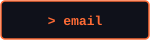</a>






<table>
<tr>
  <td width="50%" valign="top" align="center">
    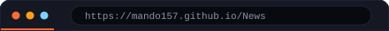 
    <a href="https://mando157.github.io/News/">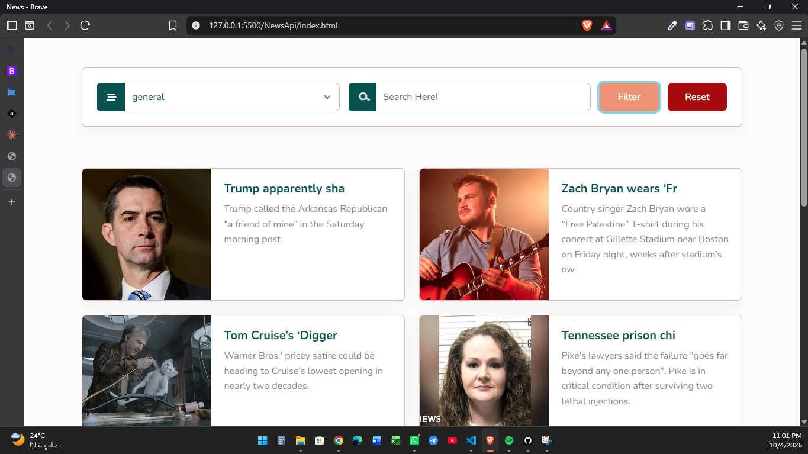</a> 
    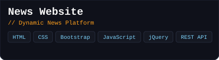 
    A responsive news platform powered by <b>NewsAPI</b> with categories, search, dynamic rendering and pagination.  
    <a href="https://mando157.github.io/News/">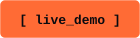</a>&nbsp;&nbsp;<a href="https://github.com/mando157/News">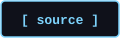</a>  
  </td>
  <td width="50%" valign="top" align="center">
    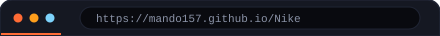 
    <a href="https://mando157.github.io/Nike/">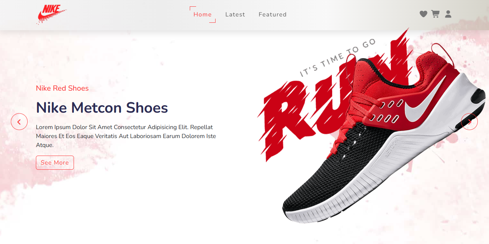</a> 
    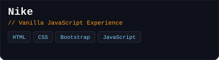 
    A Nike-inspired interface built from scratch with <b>Vanilla JavaScript</b>, focused on interactions and dynamic UI.  
    &nbsp;&nbsp;  
  </td>
</tr>
<tr>
  <td width="50%" valign="top" align="center">
    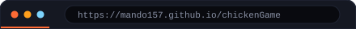 
    <a href="https://mando157.github.io/chickenGame/">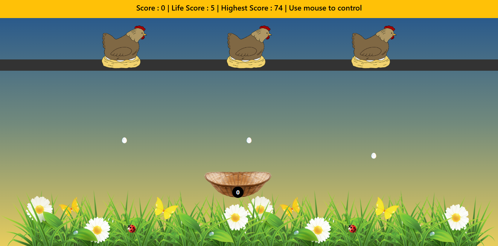</a> 
    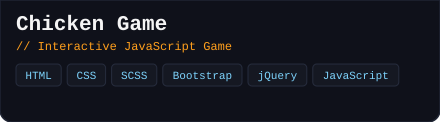 
    A browser game with <b>keyboard controls, animation loops, collision handling</b> and scoring.  
    <a href="https://mando157.github.io/chickenGame/">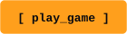</a>&nbsp;&nbsp;  
  </td>
  <td width="50%" valign="top" align="center">
    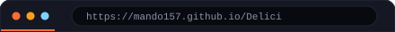 
    <a href="https://mando157.github.io/Delici/">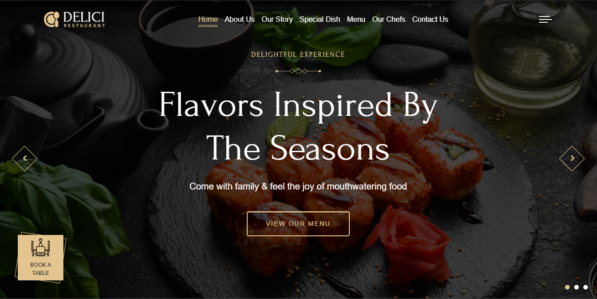</a> 
    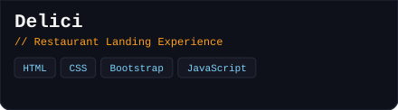 
    A responsive restaurant website focused on <b>layout, typography and visual hierarchy</b>.  
    &nbsp;&nbsp;  
  </td>
</tr>
<tr>
  <td width="50%" valign="top" align="center">
    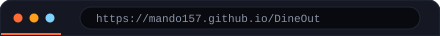 
    <a href="https://mando157.github.io/DineOut/">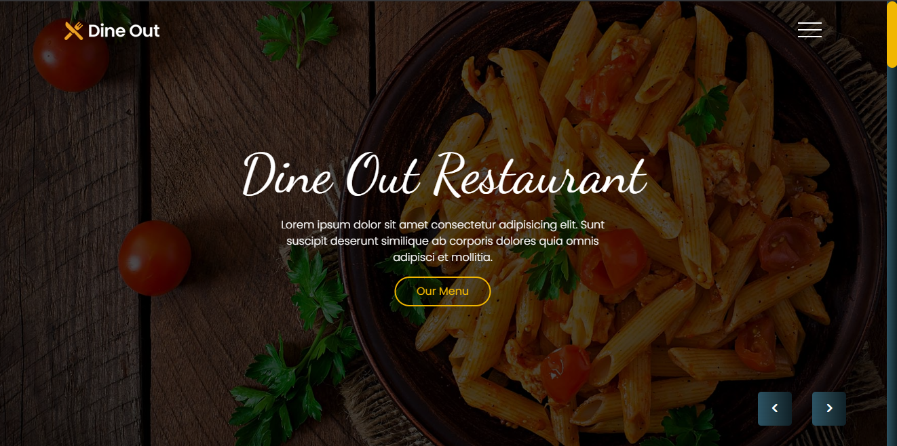</a> 
    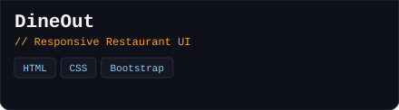 
    A modern restaurant interface built with <b>reusable Bootstrap components</b> and clean structure.  
    &nbsp;&nbsp;  
  </td>
  <td width="50%" valign="top" align="center">
     
    <a href="https://mando157.github.io/luxora/">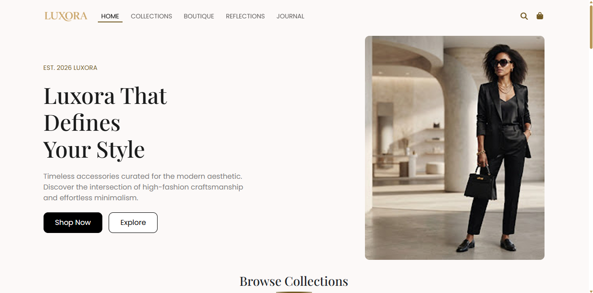</a> 
    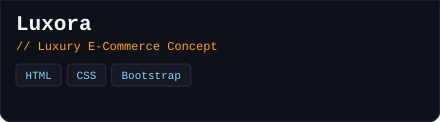 
    One of my early complete projects, from <b>design to final implementation</b>.  
    &nbsp;&nbsp;  
  </td>
</tr>
<tr>
  <td width="50%" valign="top" align="center">
    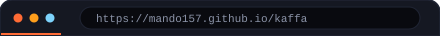 
    <a href="https://mando157.github.io/kaffa/">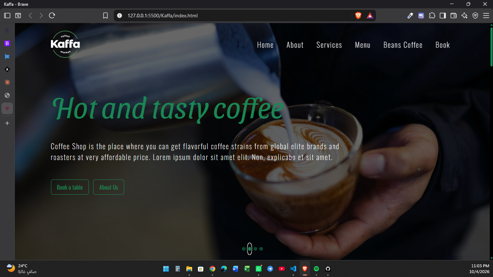</a> 
    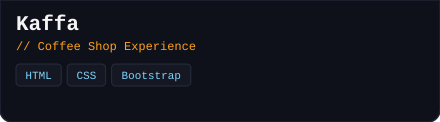 
    A coffee shop website with <b>Bootstrap and custom styling</b>, focused on layout and components.  
    &nbsp;&nbsp;  
  </td>
  <td width="50%" valign="top" align="center">
    
  </td>
</tr>
</table>


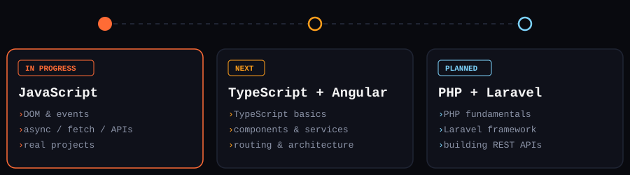


  
  

  


  &nbsp;
  &nbsp;
  &nbsp;
  <a href="https://wa.me/201110257589">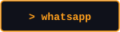</a>

  


